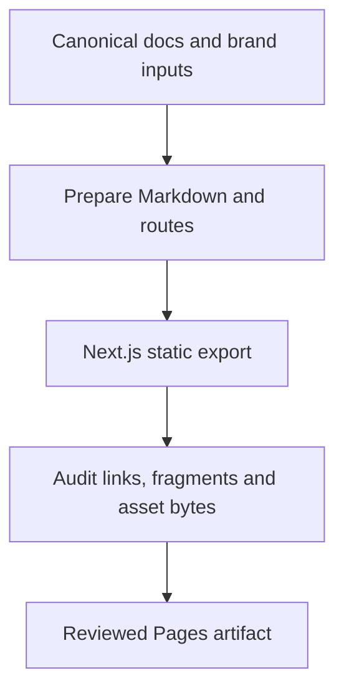

# Website and comparison maintenance

The public site at https://go-schedule.io/ is a static Next.js export with Fumadocs, deployed by GitHub Actions to GitHub Pages. Cloudflare provides DNS only. Edit documentation in `docs/`; `site/content/`, `.source/`, copied public assets and `out/` are generated. The site build consumes the same official assets declared for `docs/assets` in the brand consumer map. Do not edit generated copies.

## Build and content changes

Use Node 26 and the exact site lockfile. From `site/`, run `npm ci`, `npm test` and `npm run build`. Run `npm run test:browser` after installing Chromium with `npx playwright install chromium` for production search, appearance, keyboard, diagram, redirect and responsive checks. `node scripts/serve.mjs` serves the existing export on loopback port 4174 for local inspection. Documentation metadata retains `title` and numeric `nav_order` as the canonical navigation contract. The preparation step maps documents and relative links to `/docs/`, copies assets and emits a source-route inventory. The export step adds legacy HTML aliases and audits internal paths, fragment targets and unchanged canonical asset bytes.

The home is `/`, documentation is `/docs/` and the comparison is `/compare/`. Original document headings and their fragment IDs remain in the compiled Markdown. Legacy documentation-index fragments on the old home lead to the matching `/docs/` section. Old case-sensitive URLs such as `/INSTALL-windows.html` retain static redirect pages, including query and fragment. Next runtime redirects, image optimization and server search endpoints are not available on Pages. Search uses the exported `/static.json` index. The source and code examples remain Markdown, including literal command placeholders.

## Comparison evidence and release review

`site/data/comparisons/<tag>.json` contains product contexts, capability cells and opportunity links. Each cell records an explicit status, explanation, official source and review date. Unknown means the evidence does not establish the answer. Distinguish edition/add-on limitations, and keep future go-schedule work separate from released capability. Research all seven named products when reviewing; a competitor gap alone does not authorize a new feature.

For a new release, add its snapshot and a review at `site/data/reviews/<tag>.json`. The review contains `tag`, `source_ref` (`refs/tags/<tag>`), `reviewed_at`, `dataset_sha256`, `changelog_sha256`, `notes_sha256` and `decisions`. Decisions map every capability ID to `changed` or `no-change`; every capability in the snapshot has an explicit decision. The three digests cover exact snapshot bytes, the exact tag's changelog section, and `.github/release-notes/<tag>.md` bytes. Use the helper below to produce a template and then fill every decision after review:

```sh
node site/scripts/review-release.mjs v1.6.0
go run ./scripts/comparison-check -tag v1.6.0 -commit <resolved-tag-commit>
```

The helper deliberately emits `review-required` decisions, which the gate rejects until replaced. Re-run it or update digests only after reviewing changed content. A candidate commit hash cannot be committed inside its own review; workflows resolve the exact tagged commit and record it together with the reviewed content digests. No arbitrary calendar expiry replaces that identity check.

Release staging and both normal and standing-waiver promotion call the same guard before release mutation. The waiver does not bypass comparison maintenance. Structural validation runs through `go run ./scripts/comparison-check`. The Pages workflow follows successful completion of both promotion workflows, as well as manual release publication and main updates. This avoids relying on a release event suppressed when promotion uses `GITHUB_TOKEN`. It checks out main and selects the latest public release tag and requires its matching snapshot; merging a candidate snapshot does not publish it as released capability. Local preview defaults to `site/data/published.json`, or explicitly sets `SITE_RELEASE_TAG` for a matching snapshot. Update the recorded local default when a new release becomes public.

## Domain ownership and cutover handoff

Target: https://go-schedule.io/ on GitHub Pages, with Cloudflare managing DNS. Authentication, zone inventory and all public mutations are separate operations. The owner completes Cloudflare sign-in/MFA or securely provisions a token scoped to this zone with DNS Edit and Zone Read. Never put tokens in commands, issues, logs or repository files. GitHub organization ownership verification requires organization-owner authority; Pages settings require repository admin access.

Before changing anything, confirm the exact zone/account, active authoritative nameservers, current apex/www/TXT/CAA records and Pages settings. Retain a private redacted before-state with record IDs and rollback values. Preserve mail and unrelated records. Verify the domain in the shruggietech organization Pages settings using GitHub's exact challenge TXT and retain it. Bind the custom domain to this repository before directing traffic there.

The proposed DNS-only records are:

| Type | Name | Content |
| --- | --- | --- |
| A | @ | 185.199.108.153 |
| A | @ | 185.199.109.153 |
| A | @ | 185.199.110.153 |
| A | @ | 185.199.111.153 |
| AAAA | @ | 2606:50c0:8000::153 |
| AAAA | @ | 2606:50c0:8001::153 |
| AAAA | @ | 2606:50c0:8002::153 |
| AAAA | @ | 2606:50c0:8003::153 |
| CNAME | www | shruggietech.github.io |

Use DNS only initially (`proxied: false`) and automatic TTL. Match existing records by name/type/content and update only identified conflicts. Do not create a duplicate zone, include `/go-schedule` in DNS, or create wildcards. GitHub supplies the www-to-apex redirect when the apex is canonical and both are configured. Check CAA only if certificate issuance requires it; preserve unrelated TLS policy.

For a domain cutover, switch Pages to GitHub Actions, retain/set the repository's custom domain, deploy the reviewed export, apply the prepared DNS changes, wait for DNS/certificate provisioning and enforce HTTPS. Actions publishing uses the repository domain setting; it does not require a source CNAME file. Check apex/www/HTTP/old-site links, representative deep links/assets and IPv4/IPv6 HTTPS. Only after replacement delivery should discovery links change and obsolete publishing inputs be retired.

The 2026-10-19 S106 cutover replaces the former main:/docs Jekyll publisher. The organization ownership TXT remains in Cloudflare alongside four apex A records, four apex AAAA records and the www CNAME, all with DNS-only status and automatic TTL. The repository homepage and README links use the canonical domain. The old Jekyll configuration, includes, styles and their temporary pre-cutover regression are retired together. Deployment and public verification evidence is recorded in [S106 delivery](https://github.com/shruggietech/go-schedule/blob/main/specs/106-public-web-presence/delivery.md) and issue #278.

Rollback retains the organization ownership TXT and custom-domain binding while restoring a known-good Pages Actions deployment or reviewed source revert. Returning to the original branch publisher additionally requires restoring the five legacy Jekyll files from commit 432452e7e59843b279f902d15c92289e6726f062 before switching Pages to main:/docs. The pre-cutover domain had no traffic records; remove only the nine traffic records introduced by this cutover if restoring that DNS baseline, and coordinate settings/content so traffic never targets an unbound site.

## Official references

- [GitHub custom domains and record values](https://docs.github.com/en/pages/configuring-a-custom-domain-for-your-github-pages-site/managing-a-custom-domain-for-your-github-pages-site)
- [Organization domain verification](https://docs.github.com/en/pages/configuring-a-custom-domain-for-your-github-pages-site/verifying-your-custom-domain-for-github-pages)
- [GitHub workflow completion events](https://docs.github.com/en/actions/reference/workflows-and-actions/events-that-trigger-workflows#workflow_run) and [token-trigger restrictions](https://docs.github.com/en/actions/how-tos/write-workflows/choose-when-workflows-run/trigger-a-workflow#triggering-a-workflow-from-a-workflow)
- [GitHub Pages Actions publishing](https://docs.github.com/en/pages/getting-started-with-github-pages/using-custom-workflows-with-github-pages)
- [Cloudflare record management](https://developers.cloudflare.com/dns/manage-dns-records/how-to/create-dns-records/) and [scoped API tokens](https://developers.cloudflare.com/fundamentals/api/get-started/create-token/)

## Static publication pipeline


