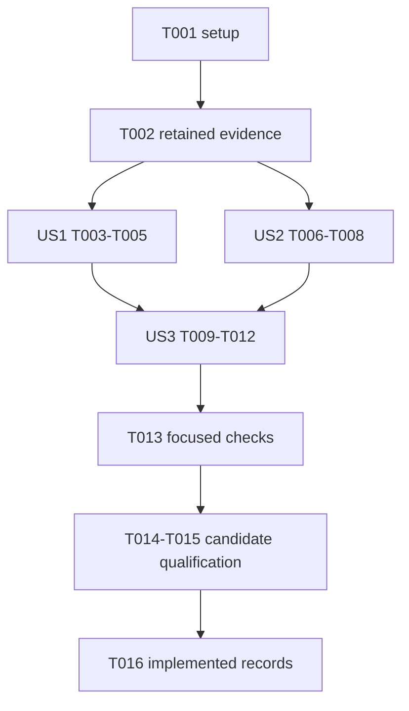

# Tasks: S134 Maintenance Convergence and First-use Release Handoff

**Input**: [plan.md](plan.md), [spec.md](spec.md), [research.md](research.md), [data-model.md](data-model.md), [contracts/maintenance.md](contracts/maintenance.md).

**Tests**: Constitution-mandated regression discipline uses the retained original production-browser failure and failing-first cases in the existing timeout checker. All canonical safety-critical suites remain.

## Phase 1: Setup

- [x] T001 Inventory the accepted baseline and protected prior evidence in .test-temp/s134/protected-inputs.json; preserve historical release bytes and source identities.

## Phase 2: Foundational Evidence

- [x] T002 Retain #429's original browser failure and #430's failed/recovered Pages receipts under .test-temp/s134/ and create specs/134-maintenance-convergence-publication/verification.md with honest pending evidence.

## Phase 3: User Story 1 - Finish First-task Navigation (P1)

**Goal**: Every platform link finishes its expected route/document before another guide is requested, with attributable failure diagnostics.

**Independent validation**: Existing production first-task case, all three platform entries, unchanged content/mobile assertions and generated context/trace paths.

- [x] T003 [US1] Coordinate route completion in the platform loop in site/e2e/site.spec.ts without sleeps, automatic test retries or removed assertions; synchronize the unchanged mobile overflow bound with settled layout (FR-001, FR-002).
- [x] T004 [US1] Add bounded failure-only website diagnostic retention in .github/workflows/ci.yml and per-test capture destinations in site/e2e/site.spec.ts with run/attempt identity and the original unsuccessful browser result (FR-003).
- [x] T005 [US1] Exercise the existing first-task browser case and inspect generated diagnostic/artifact wiring; record outcomes in specs/134-maintenance-convergence-publication/verification.md (FR-001, FR-002, FR-003).

## Phase 4: User Story 2 - Effective Pages Policy (P1)

**Goal**: Configuration, validation and documentation describe the actual supported action deadline and existing attributable recovery.

**Independent validation**: Existing checker accepts 600000 ms, rejects unsupported/missing/shortened declarations, preserves other allowances and retains distinct original/recovery receipt attribution.

- [x] T006 [US2] Update regression fixtures in scripts/ci-timeout-check/main_test.go for the supported ceiling and old clamped input, and retain a failing-first observation before the checker fix (FR-004, FR-005).
- [x] T007 [US2] Align scripts/ci-timeout-check/main.go, .github/workflows/pages.yml and docs/ci-timeouts.md on the supported ceiling and source/artifact-bound recovery while preserving outer budgets (FR-004, FR-005, FR-006).
- [x] T008 [US2] Run the focused policy regression suite and actual repository checker, recording results in specs/134-maintenance-convergence-publication/verification.md (FR-004, FR-005, FR-006).

## Phase 5: User Story 3 - Coherent Maintenance Candidate (P2)

**Goal**: Deliver one traceable source candidate and concrete existing-workflow continuation without claiming unperformed public delivery.

**Independent validation**: Proposal/manifest/lock/graph and actual license deltas, release-source/comparison binding, current public selection and explicit owner boundaries.

- [x] T009 [US3] Consolidate #426-#428 in go.mod/go.sum, desktop/frontend/package.json/package-lock.json and site/package.json/package-lock.json, selecting Next 16.4.5 as the documented superseding patch (FR-007).
- [x] T010 [US3] Validate both Go module graphs/checksums and clean npm installs/audits; record actual package/license metadata deltas under .test-temp/s134/ without forcing unused desktop dependencies (FR-007).
- [x] T011 [US3] Update CHANGELOG.md through its Unreleased/prepared-v2.0.1 boundary, .github/release-notes/v2.0.1.md and site/data/reviews/v2.0.1.json, preserving historical records, comparison conclusions and public v2.0.0 selection (FR-008).
- [x] T012 [US3] Write specs/134-maintenance-convergence-publication/handoff.md and delivery.md with the two-request ledger boundary and later exact-source/actual-asset approval sequence; preserve individual #429/#430 versus #419 outcomes (FR-009, FR-010).

## Phase 6: Cross-cutting Qualification and Delivery Records

- [x] T013 Run focused CLI/frontend/source/publication checks and transition spec.md plus specs/README.md to In Progress before complete qualification; preserve all existing assertion/resource contracts.
- [x] T014 Run the full foreground scripts/verify.sh all, desktop/site production browser contracts and fresh scripts/cli-qa.ps1 build/capture against quiescent source, retaining original failures and source/protected-input snapshots.
- [x] T015 Review every current QA message, finalize/validate/render through scripts/cli-qa.ps1 and record failed, not-applicable and owned-cleanup outcomes honestly in verification.md.
- [x] T016 Resolve all required source tasks and update only bounded factual spec.md/tasks.md/verification.md/delivery.md plus specs/README.md records to Implemented after evidence exists; complete final source/history/encoding/lifecycle and protected-input audits.

## Dependencies and Execution Order

US1 and US2 are independently implementable after foundational evidence. Within US2, T006 precedes T007 and T008. The integrated candidate includes both source outcomes before qualification. Publication workflow, review requests and owner merge are recorded outside these implementation checkboxes.

## Parallel Opportunities

- US1 site/e2e/site.spec.ts and US2 scripts/ci-timeout-check/main_test.go are independent after T002.
- Dependency metadata inspection and license comparison may proceed alongside documentation drafting, with mutations to each manifest/lock pair kept sequential.
- Complete qualification is sequential and foreground; source remains quiescent throughout. This task graph does not authorize additional coding agents.

## Implementation Strategy

Deliver US1's route/diagnostic correction and US2's supported-deadline policy independently, then integrate the bounded dependency/source-record increment. Reuse existing verification, QA and publication machinery. The actual public-release finish remains #419's same-slice continuation after the explicit owner merge stop and later concrete approvals.
